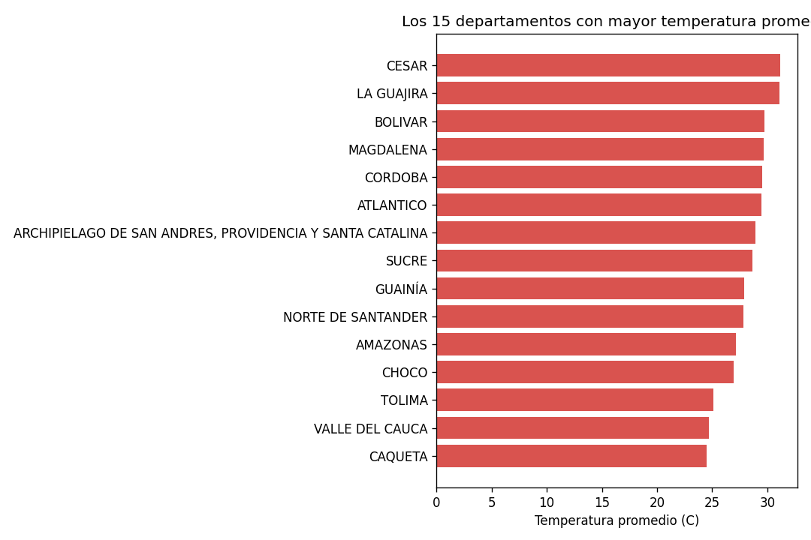
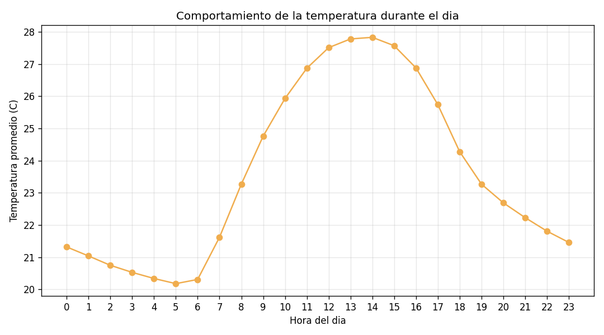
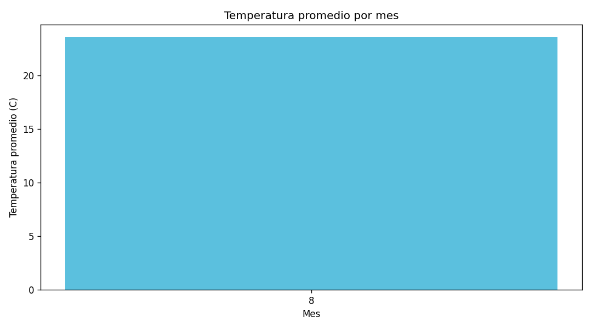
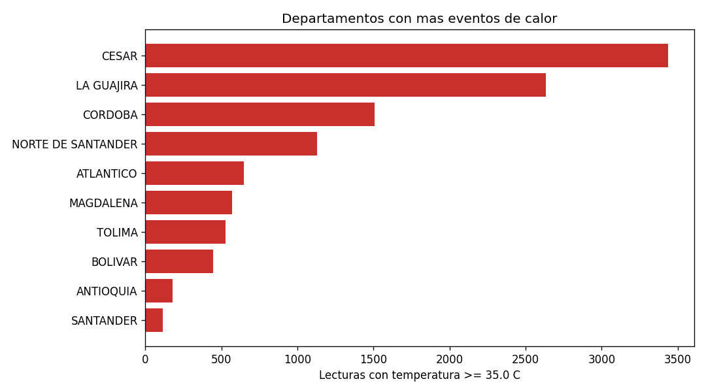

# Procesamiento en batch con Apache Spark: Temperatura Ambiente del Aire (IDEAM)

Tarea 3 - Procesamiento de Datos con Apache Spark
Curso: Big Data (código 202016911) - Universidad Nacional Abierta y a Distancia (UNAD)
Autor: Gustavo Andrés Lambraño Pérez

## Descripción del problema

Colombia tiene estaciones automáticas del IDEAM que registran la temperatura del aire de forma continua. Con esos datos se busca identificar en qué departamentos, estaciones y horas del día se concentran las temperaturas más altas, como apoyo para alertas tempranas de calor extremo.

## Conjunto de datos

- Nombre: Temperatura Ambiente del Aire
- Fuente: IDEAM, publicado en Datos Abiertos Colombia
- Enlace: https://www.datos.gov.co/Ambiente-y-Desarrollo-Sostenible/Temperatura-Ambiente-del-Aire/sbwg-7ju4
- Subconjunto usado: lecturas del 1 al 31 de agosto de 2026, descargadas directamente de la API de la fuente original con un filtro por fecha (la tabla completa es demasiado grande para la máquina virtual).
- Tamaño del subconjunto: 361.480 registros.
- Formato: CSV con encabezado.

Columnas principales: `codigoestacion`, `codigosensor`, `fechaobservacion`, `valorobservado`, `nombreestacion`, `departamento`, `municipio`, `zonahidrografica`, `latitud`, `longitud`, `descripcionsensor`, `unidadmedida`.

## Qué hace el script (`batch_temperatura.py`)

1. **Carga**: lee el CSV desde HDFS (o desde una ruta que se le pase por parámetro) y muestra el esquema y unas filas de muestra.
2. **Limpieza y transformación**:
   - Convierte `valorobservado` a número y `fechaobservacion` a fecha-hora.
   - Normaliza texto (mayúsculas y sin espacios sobrantes) en departamento y municipio.
   - Elimina registros con valores nulos, duplicados y lecturas fuera del rango -10 a 50 °C.
   - Crea columnas derivadas: año, mes, hora y una marca de evento de calor (>= 35 °C).
3. **Análisis exploratorio (EDA)**:
   - Estadísticas descriptivas de la temperatura.
   - Conteo por departamento con RDD (`map` y `reduceByKey`).
   - Temperatura por departamento, top de estaciones, comportamiento por hora y por mes.
   - Eventos de calor por departamento.
4. **Visualización**: genera 4 gráficas en PNG y 2 tablas resumen en CSV.

## Estructura del repositorio

| Elemento | Descripción |
|---|---|
| `batch_temperatura.py` | Script de procesamiento en batch con PySpark |
| `README.md` | Descripción de la solución e instrucciones de ejecución |
| `resultados/` | Gráficas generadas por el script |

## Requisitos

- Ubuntu con Java 11
- Hadoop (HDFS) y Apache Spark instalados
- Python 3 con `matplotlib` y `pandas`:

```bash
pip install matplotlib pandas
```

## Instrucciones de ejecución

### 1. Descargar el dataset y subirlo a HDFS

Con el usuario `hadoop`: iniciar Hadoop y verificar que esté corriendo (deben aparecer NameNode y DataNode).

```bash
start-all.sh
jps
```

Descargar solo agosto de 2026 desde la fuente original:

```bash
wget -O temperatura.csv 'https://www.datos.gov.co/resource/sbwg-7ju4.csv?$where=fechaobservacion%20between%20%272026-08-01T00:00:00%27%20and%20%272026-08-31T23:59:59%27&$limit=2000000'
```

Crear la carpeta en HDFS y subir el archivo:

```bash
hdfs dfs -mkdir -p /Tarea3_Temperatura
hdfs dfs -put temperatura.csv /Tarea3_Temperatura/
hdfs dfs -ls /Tarea3_Temperatura
```

### 2. Ejecutar el análisis

Con el usuario `vboxuser`, usando la ruta por defecto (`hdfs://localhost:9000/Tarea3_Temperatura/temperatura.csv`):

```bash
python3 batch_temperatura.py
```

También se puede ejecutar con `spark-submit batch_temperatura.py`, o indicando otra ruta como parámetro, por ejemplo un archivo local:

```bash
python3 batch_temperatura.py file:///home/vboxuser/temperatura.csv
```

### 3. Ver los resultados

Se guardan en la carpeta `~/resultados_batch` de la máquina virtual (en este repositorio las gráficas y las tablas están copiadas en la carpeta `resultados`):

| Archivo | Contenido |
|---|---|
| `1_temperatura_por_departamento.png` | 15 departamentos con mayor temperatura promedio |
| `2_temperatura_por_hora.png` | Temperatura promedio según la hora del día |
| `3_temperatura_por_mes.png` | Temperatura promedio por mes |
| `4_eventos_de_calor.png` | Departamentos con más lecturas >= 35 °C |
| `resumen_por_departamento.csv` | Tabla resumen por departamento |
| `top_estaciones.csv` | 20 estaciones con mayor temperatura promedio |

Como la máquina virtual no tiene entorno gráfico, las imágenes se pueden ver desde el navegador del computador sirviendo la carpeta:

```bash
cd ~/resultados_batch
python3 -m http.server 8000
```

y abriendo `http://IP_DE_LA_VM:8000` (la IP se consulta con `hostname -I`).

## Resultados obtenidos

Con el subconjunto de agosto de 2026:

- Se cargaron 361.480 registros. Después de aplicar las validaciones (nulos, duplicados y rango de -10 a 50 °C) no se eliminó ningún registro, es decir, los datos de este mes llegaron limpios.
- Departamentos con más lecturas de calor (>= 35 °C):

| Departamento | Lecturas >= 35 °C | Lecturas totales | Porcentaje |
|---|---|---|---|
| Cesar | 3.437 | 15.660 | 21,95 % |
| La Guajira | 2.632 | 17.246 | 15,26 % |
| Córdoba | 1.505 | 14.968 | 10,05 % |
| Norte de Santander | 1.129 | 16.044 | 7,04 % |
| Atlántico | 647 | 15.027 | 4,31 % |

- Cesar y La Guajira concentran el mayor número de eventos de calor del mes, y en Cesar más de una de cada cinco lecturas llegó a 35 °C o más.
- Por hora del día, la temperatura promedio baja de forma sostenida durante la tarde y la noche: pasa de 25,74 °C a las 17:00 a 21,46 °C a las 23:00.
- Departamentos con mayor temperatura promedio:

| Departamento | Promedio (°C) | Máxima (°C) | Mínima (°C) | Lecturas |
|---|---|---|---|---|
| Cesar | 31,18 | 41,9 | 17,8 | 15.660 |
| La Guajira | 31,10 | 42,7 | 22,7 | 17.246 |
| Bolívar | 29,76 | 44,7 | 22,4 | 16.328 |
| Magdalena | 29,66 | 40,3 | 22,4 | 15.656 |
| Córdoba | 29,55 | 39,6 | 22,1 | 14.968 |
| Atlántico | 29,45 | 40,4 | 22,3 | 15.027 |

- Estaciones con mayor temperatura promedio (con al menos 100 lecturas): Hobo - AUT en Bolívar (34,02 °C, máxima de 44,7 °C), Ipichirrain (32,32 °C) y La Paulina (32,12 °C) en La Guajira, y Fedearroz - AUT en Cesar (32,10 °C). Cuatro de las diez estaciones más calientes están en La Guajira.
- Conteo de registros con RDD (`map` y `reduceByKey`): Antioquia (39.037), Boyacá (23.994), Santander (20.520), Nariño (19.113) y Chocó (17.857) son los departamentos con más registros. Antioquia es el que más lecturas aporta, pero solo el 0,46 % supera los 35 °C.
- Limitación de los datos: el filtro de validación (-10 a 50 °C) solo descarta lecturas imposibles. Algunos departamentos muestran mínimos de 0,0 °C (Norte de Santander) y 0,5 °C (San Andrés), que probablemente son fallas de sensor y no temperaturas reales; un filtro más estricto por zona sería una mejora para trabajos futuros.
- Las gráficas completas están en la carpeta [`resultados`](resultados/):






## Parámetros que se pueden ajustar

Están al inicio del script:

- `UMBRAL_CALOR`: temperatura (°C) desde la cual se considera evento de calor (por defecto 35).
- `TEMP_MIN` y `TEMP_MAX`: rango de temperaturas considerado válido.
- `CARPETA_SALIDA`: carpeta donde se guardan los resultados.

## Procesamiento en tiempo real (complemento)

La parte de streaming de esta tarea se desarrolló siguiendo el Anexo 3 de la guía, con Apache Kafka y Spark Streaming, y se muestra en el video de la entrega:

- Tema (topic) de Kafka: `sensor_data`
- Productor: genera lecturas simuladas de sensores (temperatura y humedad) y las envía a Kafka.
- Consumidor con Spark Streaming: calcula promedios por ventana de 1 minuto y por sensor, y los muestra en consola.
- Requisitos: Apache Kafka 3.9.2 con ZooKeeper, la librería `kafka-python` y Spark con el paquete `spark-sql-kafka-0-10` (con la misma versión de Spark instalada).
